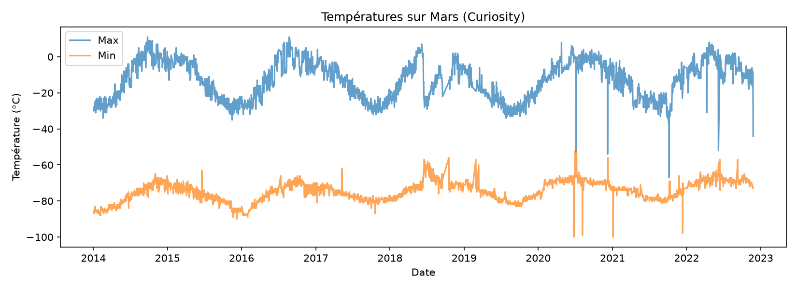
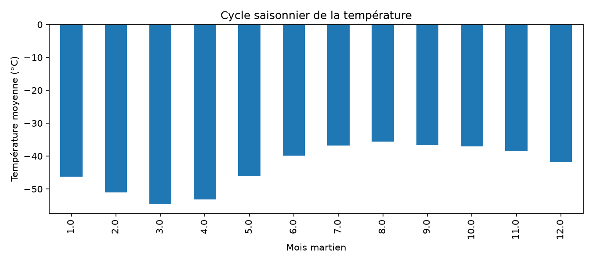
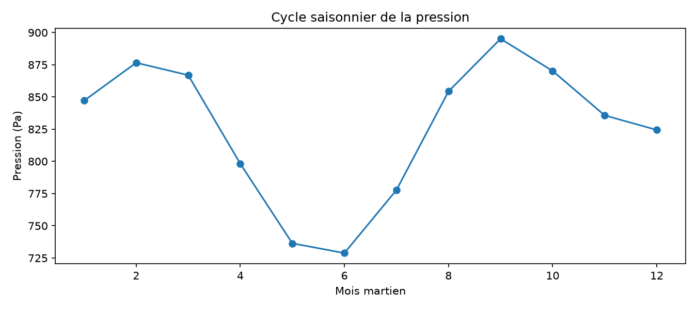

# 🔴 Mars Weather Analysis

Analysis of Mars weather measurements from the Curiosity rover, using Python
and pandas: data cleaning, seasonal aggregation, correlations and charts.

## Dataset
"Mars Weather Data" from Kaggle (author: The Devastator), 3,036 daily records
from January 2014 to November 2022. Columns used: date, min/max temperature,
pressure, Mars month.

## What the code does
- Cleans the data: removes duplicates, converts dates and numbers,
  drops the empty `wind_speed` column and rows without measurements
- Computes average temperature and daily temperature range
- Groups measurements by Mars month and by Earth year
- Computes correlations and generates charts

## Key findings
- Average temperature varies by about 19 °C across Mars months
  (coldest in month 3, warmest in month 8)
- Pressure follows a seasonal cycle, lowest in months 5-6 and highest in month 9
- The daily gap between min and max is about 62 °C on average
- The linear correlation between pressure and temperature is weak (about -0.08)

## Charts

## Limitations
- The "average temperature" is the mean of the daily min and max, not a
  true daily average
- A weak linear correlation does not mean there is no relationship

## Run it
1. `python -m venv venv` and activate it
2. `pip install -r requirements.txt`
3. `python analyze.py`

## Project structure
- `clean.py`: loading and cleaning
- `analyze.py`: statistics and charts
- `data/mars_weather.csv`: dataset
- `images/`: generated charts

## Tech stack
Python, pandas, matplotlib